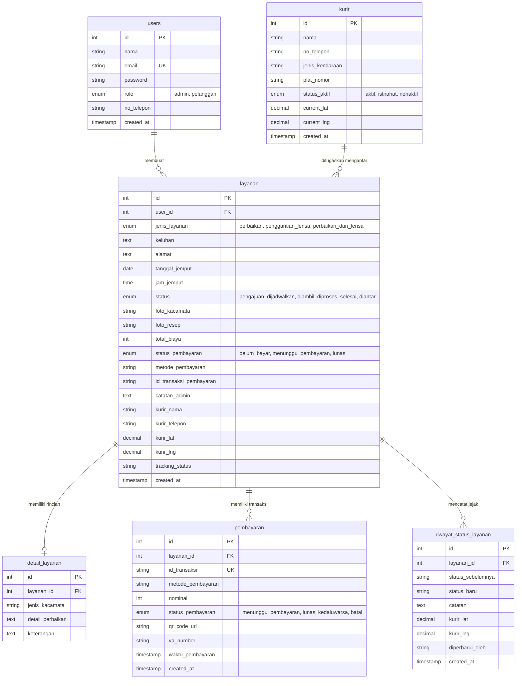

# 🏗️ Arsitektur Sistem & Spesifikasi Basis Data

## 1. Arsitektur Perangkat Lunak (3-Tier Architecture)

OptikExpress dibangun menggunakan pendekatan arsitektur **3-Tier Client-Server**:

```
+--------------------------------------------------------------+
|                    PRESENTATION LAYER                        |
|   React.js 18 (Single Page Application)                      |
|   - Routing: React Router DOM v6 (Private Routes & Guards)   |
|   - State Management: React Hooks (useState, useEffect)      |
|   - Maps: Leaflet OpenStreetMap + Custom DivIcons & Polyline |
|   - HTTP Client: Axios dengan Interceptor JWT Token          |
+--------------------------------------------------------------+
                               |
                               | REST API (JSON via HTTP)
                               v
+--------------------------------------------------------------+
|                     APPLICATION LAYER                        |
|   Node.js & Express.js RESTful API                           |
|   - Middleware: JWT Authentication (Bearer Token)            |
|   - Authorization: Role-Based Access Control (Admin / User)  |
|   - Service Dispatcher: Auto-Assign Courier Engine           |
|   - Payment Mock Engine: Midtrans Sandbox Simulation         |
|   - Notifications: Nodemailer (SMTP) & WhatsApp Logger       |
+--------------------------------------------------------------+
                               |
                               | SQL Queries (mysql2/promise)
                               v
+--------------------------------------------------------------+
|                       DATA LAYER                             |
|   MySQL / MariaDB RDBMS (Database: db_kacamata)              |
|   - InnoDB Engine dengan Foreign Key Constraints             |
|   - 6 Normalized Tables (3NF)                                |
|   - Auto-Migration on Boot (ensureTableColumns)              |
+--------------------------------------------------------------+
```

---

## 2. Diagram Hubungan Entitas (ERD 6 Tabel Relasional)



---

## 3. Siklus Operasional Layanan (Finite State Machine)

Setiap pesanan perbaikan kacamata bergerak secara sekuensial mengikuti aturan alur kerja bisnis:

```
[ pengajuan ] ──> Pelanggan membuat pesanan servis & upload foto kacamata/resep
      │
      ▼
[ dijadwalkan ] ─> Admin verifikasi & sistem auto-assign kurir dari armada optik
      │
      ▼
[   diambil   ] ─> Kurir meluncur ke rumah pelanggan untuk menjemput frame kacamata
      │
      ▼
[  diproses   ] ─> Kacamata tiba di lab optik, teknisi memperbaiki & ganti lensa
      │
      ▼
[   diantar   ] ─> Pengerjaan tuntas, kurir mengantar kembali (Live GPS tracking aktif)
      │
      ▼
[   selesai   ] ─> Kacamata diterima pelanggan, transaksi selesai (LUNAS)
```
