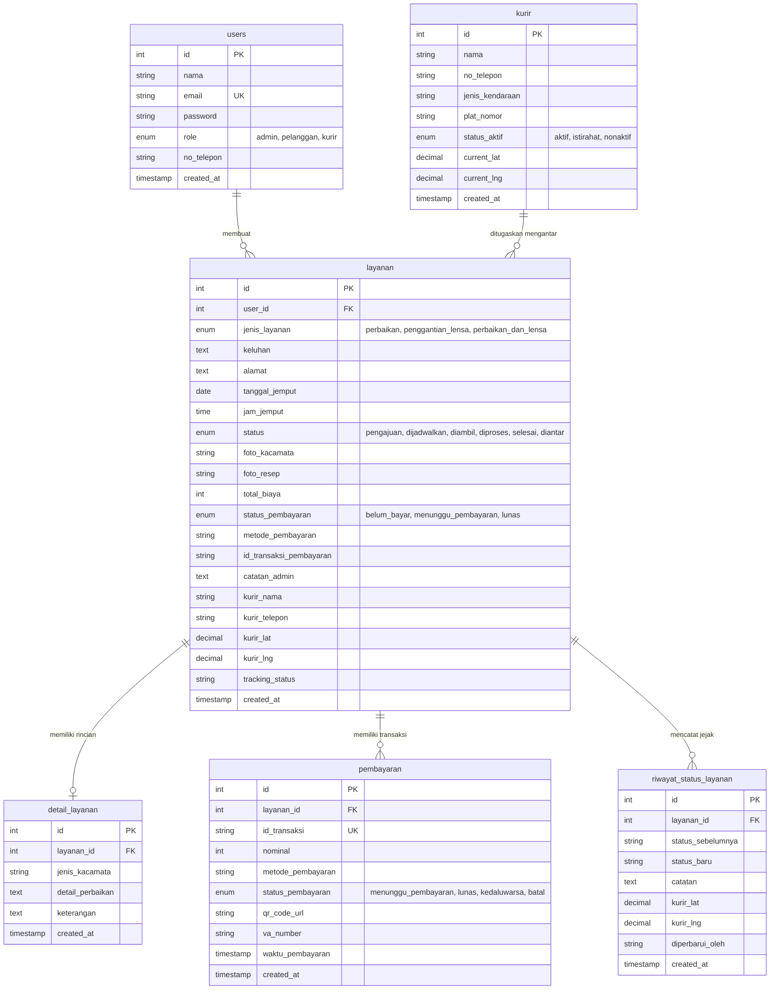

# PANDUAN GAYA KODE DAN ARSITEKTUR SISTEM (CODING_STYLE.MD)

**Proyek:** OptikExpress — Sistem Informasi Layanan Antar-Jemput Kacamata  
**Target:** Standardisasi arsitektur, konvensi penamaan, dan aturan rekayasa perangkat lunak.

---

## 1. Arsitektur Perangkat Lunak (3-Tier Layering)

OptikExpress mengadopsi pemisahan lapisan tanggung jawab (*Separation of Concerns*) berbasis 3-Tier:

1. **Presentation Layer (Frontend):**
   * Pustaka: React.js 18 (Functional Components dan React Hooks).
   * Navigasi: React Router DOM v6 dengan pelindung rute privat (`PrivateRoute.js`).
   * Peta Interaktif: Leaflet (OpenStreetMap) dengan koordinat custom marker kurir dan rute jalan.
   * Komunikasi Jaringan: Axios dengan interceptor otomatis penyemat token JWT.
2. **Application Layer (Backend RESTful API):**
   * Runtime: Node.js v24.22.1 LTS (Security Patch) dengan kerangka kerja Express.js 4.19.2.
   * Middleware: `auth.js` (verifikasi JWT Bearer), `adminAuth.js` (proteksi Role Admin), dan `staffAuth.js` (proteksi Staf Operasional: Admin & Kurir).
   * Engine Bisnis: Auto-Assign Courier Engine (Round-Robin), Midtrans Simulator, dan EMVCo QRIS Generator.
   * Notifikasi: Nodemailer SMTP dan WhatsApp Mock Logger.
3. **Data Layer (Database RDBMS):**
   * Database: MySQL 8.0 / MariaDB 10.4+ (`db_kacamata`).
   * Connection Pooling: `mysql2/promise` dengan konfigurasi pool connection stabil.
   * Normalisasi: 6 Tabel relasional 3NF dengan constraint `ON DELETE CASCADE`.

---

## 2. Konvensi Penamaan (Naming Conventions)

* **Komponen React:** Wajib menggunakan **PascalCase**.
  * Contoh: `Navbar.js`, `LiveMapKurir.js`, `BuatLayanan.js`, `AdminDashboard.js`, `KurirDashboard.js`.
* **Fungsi, Controller dan Variabel JavaScript:** Wajib menggunakan **camelCase**.
  * Contoh: `getAllLayanan`, `createLayanan`, `updateStatusLayanan`, `autoAssignCourier`.
* **Tabel dan Kolom Basis Data:** Wajib menggunakan **snake_case**.
  * Contoh: `layanan`, `detail_layanan`, `tanggal_jemput`, `status_pembayaran`.
* **Konstanta Global dan Enums:** Menggunakan **SCREAMING_SNAKE_CASE**.
  * Contoh: `VALID_STATUSES`, `VALID_JENIS_LAYANAN`, `VALID_METODE_PEMBAYARAN`.

---

## 3. Format Respons API Standar

Semua endpoint REST API diwajibkan mengembalikan format JSON standar:

### Respons Berhasil (HTTP 200 / 201)
```json
{
  "success": true,
  "message": "Operasi berhasil dieksekusi.",
  "data": { ... }
}
```

### Respons Gagal (HTTP 400 / 401 / 403 / 404 / 500)
```json
{
  "success": false,
  "message": "Pesan deskripsi kesalahan yang mudah dipahami klien.",
  "error": "Detail error teknis (opsional)"
}
```

---

## 4. Diagram Hubungan Entitas (ERD 6 Tabel Relasional 3NF)



---

## 5. Prinsip Keamanan dan Anti-IDOR (Insecure Direct Object References)

1. **Password Hashing:** Dilarang menyimpan password dalam bentuk teks terbuka. Wajib di-hash menggunakan BCrypt dengan *salt rounds* minimal 10.
2. **Pencegahan Akses Ilegal (Anti-IDOR):** Pada endpoint detail pesanan (`GET /api/layanan/:id`), sistem memvalidasi bahwa `user_id` pada pesanan harus sama dengan `req.user.id`, kecuali jika `req.user.role === 'admin'` atau `'kurir'`. Pelanggan lain yang mencoba membuka pesanan milik orang lain akan ditolak HTTP 403 Forbidden.
3. **Prepared Statements:** Semua query database MySQL wajib menggunakan parameter tanda tanya `?` untuk mencegah kerentanan SQL Injection.
4. **Isolasi Token:** Token JWT disimpan pada klien dan diverifikasi pada setiap request privat via header `Authorization: Bearer <token>`.

---

## 6. Struktur Direktori Proyek

```text
RPLApp/
├── backend/
│   ├── config/db.js              # Pool koneksi MySQL dan auto-migration
│   ├── controllers/              # Business logic (auth, layanan, detailLayanan)
│   ├── database/schema.sql       # DDL 6 tabel relasional 3NF dan demo seed
│   ├── middleware/               # auth.js (JWT), adminAuth.js (RBAC), staffAuth.js
│   ├── routes/                   # Routing Express API
│   ├── tests/                    # 6 berkas pengujian otomatis (node:test)
│   └── server.js                 # Entrypoint server Express (Port 5000)
├── frontend/
│   ├── src/components/           # Navbar.js, LiveMapKurir.js
│   ├── src/pages/                # Home, Login, Register, Dashboard, KurirDashboard
│   ├── src/utils/                # api.js (Axios), PrivateRoute.js
│   ├── src/App.js dan App.css    # Routing utama dan styling modern
│   └── package.json
├── docs/                         # Seluruh dokumentasi proyek
├── docker-compose.yml
└── README.md                     # Panduan setup utama di root
```
