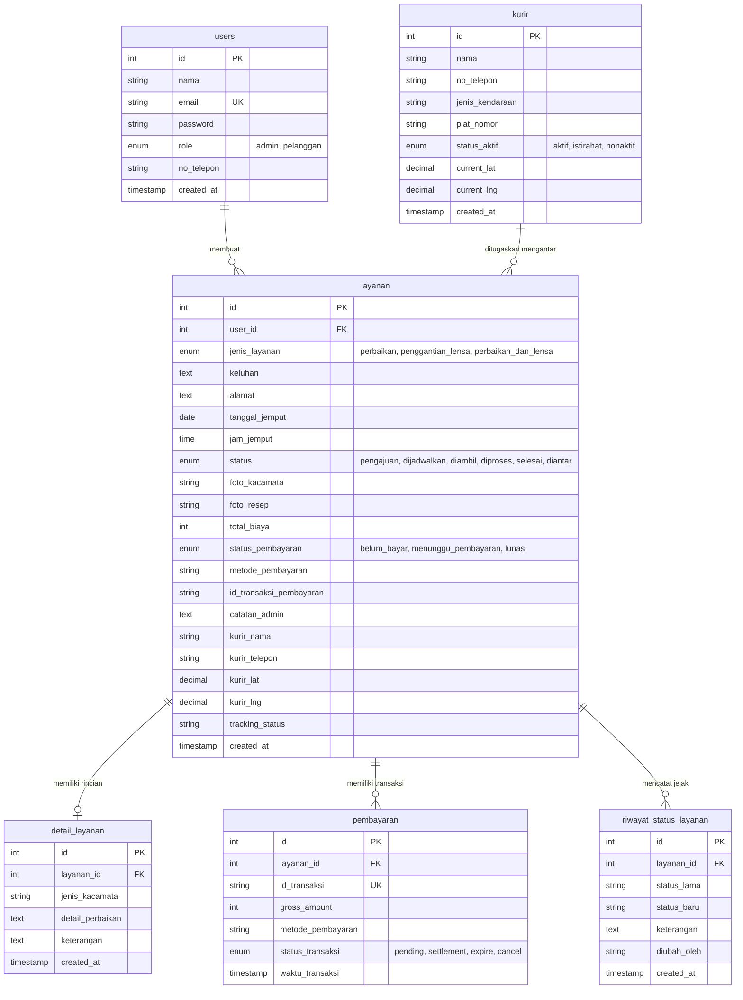

# 🏗️ PERTEMUAN 3: DOKUMEN ARSITEKTUR & SPESIFIKASI SISTEM

**Nama Aplikasi:** **OptikExpress — Sistem Informasi Layanan Antar-Jemput Kacamata**  
**Purpose:**  
Membantu pelanggan memesan perbaikan kacamata (frame rusak, sekrup lepas, bantalan hidung) dan penggantian lensa optik (minus, silinder, anti-radiasi blueray, photochromic) melalui layanan kurir antar-jemput terpercaya, memantau pergerakan kurir secara real-time pada peta GPS, serta menyelesaikan transaksi pembayaran digital multi-metode (QRIS, Virtual Account, COD).

---

## 1. Arsitektur Sistem (3-Tier Architecture)

OptikExpress mengadopsi model arsitektur **3-Tier Client-Server**:

```
+--------------------------------------------------------------+
|                    PRESENTATION LAYER                        |
|   React.js 18 (Single Page Application)                      |
|   - Routing: React Router DOM v6 (Private Routes & Guards)   |
|   - State Management: React Hooks (useState, useEffect)      |
|   - Maps: Leaflet OpenStreetMap + Custom DivIcons & Polyline |
|   - HTTP Client: Axios dengan Interceptor JWT Token          |
+--------------------------------------------------------------+
                               |
                               | REST API (JSON via HTTP)
                               v
+--------------------------------------------------------------+
|                     APPLICATION LAYER                        |
|   Node.js & Express.js RESTful API                           |
|   - Middleware: JWT Authentication (Bearer Token)            |
|   - Authorization: Role-Based Access Control (Admin / User)  |
|   - Service Dispatcher: Auto-Assign Courier Engine           |
|   - Payment Mock Engine: Midtrans Sandbox Simulation         |
|   - Notifications: Nodemailer (SMTP) & WhatsApp Logger       |
+--------------------------------------------------------------+
                               |
                               | SQL Queries (mysql2/promise)
                               v
+--------------------------------------------------------------+
|                       DATA LAYER                             |
|   MySQL / MariaDB RDBMS (Database: db_kacamata)              |
|   - InnoDB Engine dengan Foreign Key Constraints             |
|   - 6 Normalized Tables (3NF)                                |
|   - Auto-Migration on Boot (ensureTableColumns)              |
+--------------------------------------------------------------+
```

---

## 2. Tech Stack

* **Frontend:** React.js 18.2.0, React Router DOM 6.22.3, Axios 1.6.8, Leaflet OpenStreetMap, CSS3 Modern.
* **Backend:** Node.js (>= 18.x), Express.js 4.19.2, mysql2 (Connection Pool dengan Promise).
* **Database:** MySQL 8.0 / MariaDB 10.4+ (`db_kacamata`).
* **Keamanan:** JSON Web Token (`jsonwebtoken` 9.0.2), BCrypt password hashing (`bcryptjs` 2.4.3).
* **Notifikasi:** Nodemailer (SMTP) & Logger Notifikasi WhatsApp.
* **API Style:** RESTful API (JSON Payload & Status Codes).
* **Kontainerisasi:** Docker & Docker Compose (`docker-compose.yml`).

---

## 3. Code & Design Rules

* **Komponen React:** Menggunakan PascalCase (`Navbar.js`, `LiveMapKurir.js`, `BuatLayanan.js`).
* **Backend Controllers & Helpers:** Menggunakan camelCase (`getAllLayanan`, `createLayanan`, `autoAssignCourier`).
* **Format Respons JSON:** Standar format konsisten `{ success: boolean, message: string, data?: any, error?: string }`.
* **Keamanan Kredensial:** Password wajib di-hash dengan BCrypt (salt rounds 10). Token JWT divalidasi via middleware `auth.js` dan otorisasi admin via `adminAuth.js`.

---

## 4. Diagram Hubungan Entitas (ERD 6 Tabel Relasional 3NF)



---

## 5. Fitur Backend & Endpoint API

| Method | Endpoint | Akses | Deskripsi Fungsi |
| :--- | :--- | :--- | :--- |
| `POST` | `/api/auth/register` | Publik | Registrasi akun baru pelanggan |
| `POST` | `/api/auth/login` | Publik | Otentikasi kredensial & penerbitan token JWT |
| `GET` | `/api/auth/me` | Pelanggan & Admin | Mengambil data sesi pengguna aktif |
| `GET` | `/api/layanan` | Pelanggan & Admin | Ambil daftar pesanan (difilter per pengguna jika pelanggan) |
| `GET` | `/api/layanan/:id` | Pelanggan & Admin | Detail lengkap pesanan dan kacamata |
| `POST` | `/api/layanan` | Pelanggan | Ajukan permintaan servis kacamata baru |
| `PUT` | `/api/layanan/:id/status` | Khusus Admin | Ubah status pengerjaan, biaya, & kurir |
| `POST` | `/api/layanan/:id/pembayaran` | Pelanggan & Admin | Generate transaksi QRIS / VA / COD |
| `POST` | `/api/layanan/:id/pembayaran/konfirmasi` | Pelanggan & Admin | Konfirmasi pembayaran Lunas |
| `GET` | `/api/layanan/:id/tracking` | Pelanggan & Admin | Ambil koordinat GPS kurir, persentase rute, & ETA |
| `PUT` | `/api/layanan/:id/tracking` | Khusus Admin | Update posisi kurir live di peta |
| `DELETE`| `/api/layanan/:id` | Pelanggan & Admin | Batalkan pesanan berstatus pengajuan |

---

## 6. Struktur Direktori Proyek

```text
RPLApp/
├── backend/
│   ├── config/db.js              # MySQL connection pool & auto-migration
│   ├── controllers/              # Business logic (auth, layanan, detailLayanan)
│   ├── database/schema.sql       # DDL 6 tabel relasional 3NF & demo seed
│   ├── middleware/               # auth.js (JWT) & adminAuth.js (RBAC)
│   ├── routes/                   # Routing Express API
│   ├── tests/                    # 5 unit test files (48 tests all passed)
│   └── server.js                 # Server entrypoint port 5000
├── frontend/
│   ├── src/components/           # Navbar.js, LiveMapKurir.js
│   ├── src/pages/                # Home, Login, Register, Dashboard, Detail
│   ├── src/utils/                # api.js (Axios), PrivateRoute.js
│   ├── src/App.js & App.css      # Perutean & styling modern navy/cyan
│   └── package.json
├── docs/                         # Dokumentasi perkuliahan Pertemuan 1 s/d 6
├── docker-compose.yml
└── README.md                     # Panduan instalasi utama di root
```
