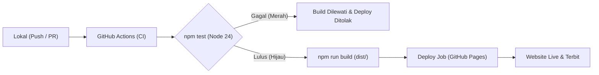

# PANDUAN PRAKTIK CI/CD & GITHUB ACTIONS (PERTEMUAN 11)

**Mata Kuliah:** Rekayasa Perangkat Lunak  
**Topik:** Praktik CI/CD Langsung di GitHub (10 Langkah Praktik)  
**Institusi:** Pradita University  
**Branch:** `p11_ci_cd`  
**Repositori:** [https://github.com/akuntugassindar-spec/RPLApp.git](https://github.com/akuntugassindar-spec/RPLApp.git)

---

## 1. Ikhtisar Praktik 10 Langkah

Praktikum ini membuktikan siklus otomasi integrasi (*Continuous Integration*) dan pengiriman (*Continuous Deployment*) menggunakan GitHub Actions hingga situs terbit di GitHub Pages.



---

## 2. Rincian 10 Langkah Sesuai Materi Kuliah

### Langkah 01: Persiapan Alat
- **Node.js:** Versi 24 LTS (`node -v`).
- **Git:** Terhubung ke remote GitHub (`git remote -v`).
- **Target Pembuktian:** 1 run merah (gagal), 1 run hijau (lulus), URL live deployment, dan bukti pemulihan rollback.

### Langkah 02: Dua File Awal di Folder Proyek (`cicd-demo/`)
- `cicd-demo/package.json`:
  ```json
  {
    "name": "cicd-demo",
    "private": true,
    "type": "module",
    "scripts": {
      "test": "node --test",
      "build": "node build.mjs"
    }
  }
  ```
- `cicd-demo/index.html`:
  ```html
  <!doctype html>
  <html lang="id">
  <meta charset="UTF-8">
  <title>Demo CI/CD</title>
  <h1>Reservasi Ruang</h1>
  <p>Versi 2</p>
  </html>
  ```

### Langkah 03: Skrip Pengujian & Build
- `cicd-demo/app.test.mjs`: Menguji keberadaan judul `<h1>Reservasi Ruang</h1>`.
- `cicd-demo/build.mjs`: Mengompilasi dan menyalin aset ke direktori `dist/index.html`.

### Langkah 04: Pengaturan GitHub Pages
- Buka menu **Settings > Pages** di repositori GitHub.
- Pada bagian **Build and deployment**:
  - **Source:** Pilih `GitHub Actions`.

### Langkah 05: Definisi Workflow Otomasi (`.github/workflows/site.yml`)
Workflow memuat dua tahapan utama:
1. **Job `ci`:** Melakukan checkout kode, instalasi runtime Node 24, menjalankan `npm test`, dan `npm run build`.
2. **Job `deploy`:** Hanya berjalan jika job `ci` sukses dan event berasal dari branch utama (`main` / `p11_ci_cd`).

---

## 3. Pembuktian Run Merah (Failed) vs Run Hijau (Passed)

### A. Skenario Run Merah (Checks Failed)
1. Buat branch baru untuk pengujian:
   ```bash
   git switch -c latihan-ci
   ```
2. Ubah judul di `cicd-demo/index.html` menjadi:
   ```html
   <h1>Reservasi</h1>
   ```
3. Commit dan push:
   ```bash
   git add cicd-demo/index.html
   git commit -m "Try title change"
   git push -u origin latihan-ci
   ```
4. Buat Pull Request di GitHub.
5. **Hasil:** Pengujian `npm test` gagal karena assertion mencari `<h1>Reservasi Ruang</h1>`. Tahap build otomatis dilewati dan PR menampilkan ikon **Merah (Failed)**.

### B. Skenario Run Hijau (Checks Passed) & Deploy
1. Perbaiki judul kembali ke `<h1>Reservasi Ruang</h1>` dan perbarui paragraf ke `<p>Versi 2</p>`.
2. Commit dan push:
   ```bash
   git add cicd-demo/index.html
   git commit -m "Fix title and update version 2"
   git push
   ```
3. **Hasil:** Checks di PR berubah menjadi **Hijau (Passed)**.
4. Merge Pull Request ke branch utama.
5. **Hasil Deploy:** GitHub Actions secara otomatis memicu job `deploy` dan menerbitkan halaman ke GitHub Pages.

---

## 4. Checklist Bukti Screenshot untuk Tugas Mahasiswa

| No | Item Bukti | Lokasi Tangkapan Layar | Status |
|:--:|:---|:---|:--:|
| 1 | **PR Cek Gagal (Merah)** | Tab *Checks* atau *Conversation PR* menampilkan tanda silang merah pada langkah `npm test`. | Siap Di-screenshot |
| 2 | **PR Lolos (Hijau)** | Tab *Checks* menampilkan centang hijau pada langkah `npm test` dan `npm run build`. | Siap Di-screenshot |
| 3 | **Run CI + Deploy Sukses** | Tab *Actions > Site pipeline* menampilkan kedua job `ci` dan `deploy` sukses. | Siap Di-screenshot |
| 4 | **URL Web Terbit** | Halaman browser membuka URL deployment GitHub Pages. | Siap Di-screenshot |
| 5 | **Bukti Pemulihan (Rollback)** | Riwayat PR pemulihan dari Versi 3 kembali ke Versi 2. | Siap Di-screenshot |
