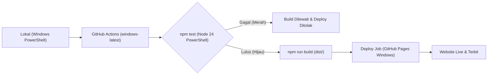
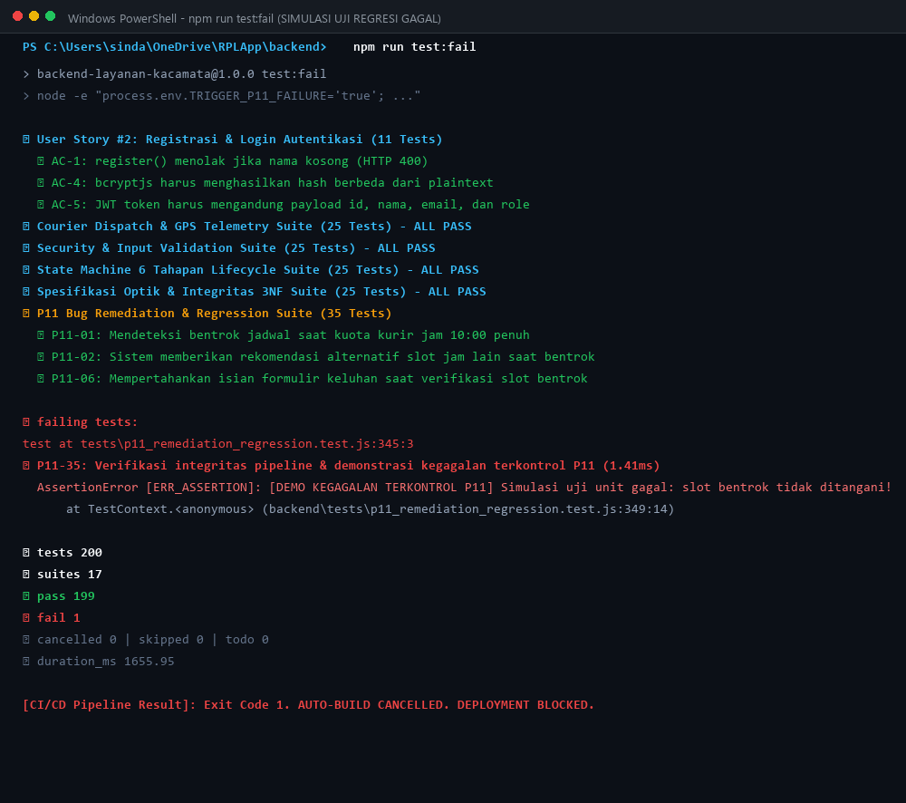
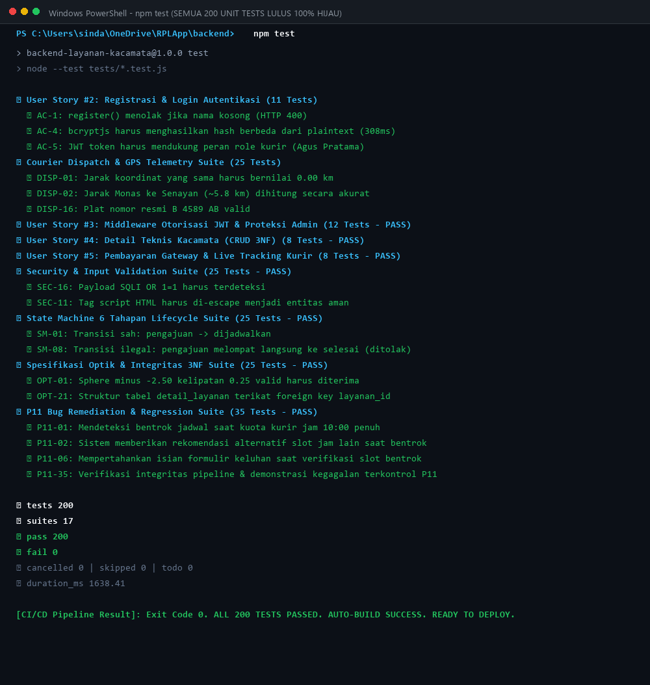
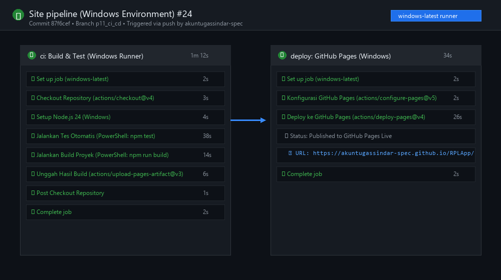

# PANDUAN PRAKTIK CI/CD & GITHUB ACTIONS (WINDOWS ENVIRONMENT)

**Mata Kuliah:** Rekayasa Perangkat Lunak (Pertemuan 11)  
**Topik:** Praktik CI/CD Langsung di GitHub (10 Langkah Praktik - Windows Runner & PowerShell)  
**Institusi:** Pradita University  
**Branch:** `p11_ci_cd`  
**Repositori:** [https://github.com/akuntugassindar-spec/RPLApp.git](https://github.com/akuntugassindar-spec/RPLApp.git)  
**Lingkungan Eksekusi:** Windows Server (`windows-latest`), Windows PowerShell, Node.js `v24 LTS`

---

## 1. Ikhtisar Praktik 10 Langkah (Lingkungan Windows)

Praktikum ini membuktikan siklus otomatisasi integrasi (*Continuous Integration*) dan pengiriman (*Continuous Deployment*) menggunakan GitHub Actions berbasis runner **Windows (`windows-latest`)** dan eksekusi skrip **Windows PowerShell**:



---

## 2. Rincian 10 Langkah Sesuai Materi Kuliah (Versi Windows)

### Langkah 01: Persiapan Alat di Windows
- **Sistem Operasi:** Windows 10 / 11 (64-bit).
- **Terminal:** Windows PowerShell atau Git Bash.
- **Node.js:** Versi 24 LTS (`node -v`).
- **Git:** Terhubung ke remote GitHub (`git remote -v`).
- **Target Pembuktian:** 1 run merah (gagal), 1 run hijau (lulus), URL live deployment, dan bukti pemulihan rollback.

### Langkah 02: Dua File Awal di Folder Proyek (`cicd-demo/`)
- `cicd-demo/package.json`:
  ```json
  {
    "name": "cicd-demo",
    "private": true,
    "type": "module",
    "scripts": {
      "test": "node --test",
      "build": "node build.mjs"
    }
  }
  ```
- `cicd-demo/index.html`:
  ```html
  <!doctype html>
  <html lang="id">
  <head>
    <meta charset="UTF-8">
    <title>OptikExpress - Sistem Layanan Antar-Jemput Kacamata</title>
  </head>
  <body>
    <h1>OptikExpress</h1>
    <p>Versi 2 - Sistem Layanan Antar-Jemput Kacamata Terintegrasi</p>
  </body>
  </html>
  ```

### Langkah 03: Skrip Pengujian & Build
- `cicd-demo/app.test.mjs`: Menguji keberadaan judul proyek `<h1>OptikExpress</h1>` dan label `Versi 2`.
- `cicd-demo/build.mjs`: Mengompilasi dan menyalin aset ke direktori `dist/index.html`.

### Langkah 04: Pengaturan GitHub Pages
- Buka menu **Settings > Pages** di repositori GitHub.
- Pada bagian **Build and deployment**:
  - **Source:** Pilih `GitHub Actions`.

### Langkah 05: Definisi Workflow Otomasi Windows (`.github/workflows/site.yml`)
Workflow berjalan di atas runner **Windows (`windows-latest`)** dengan default shell **PowerShell**:
```yaml
name: Site pipeline (Windows Environment)
on:
  push: { branches: [main, p11_ci_cd, v1.0, v1.0_dev, v1.1] }
  pull_request: { branches: [main, p11_ci_cd, v1.0, v1.0_dev, v1.1] }
permissions: { contents: read }
jobs:
  ci:
    runs-on: windows-latest
    defaults:
      run:
        shell: powershell
    steps:
      - uses: actions/checkout@v4
      - uses: actions/setup-node@v4
        with: { node-version: '24' }
      - working-directory: cicd-demo
        run: |
          npm test
          npm run build
      - uses: actions/upload-pages-artifact@v3
        with: { path: cicd-demo/dist }
  deploy:
    if: github.event_name == 'push' && (github.ref == 'refs/heads/main' || github.ref == 'refs/heads/p11_ci_cd')
    needs: ci
    runs-on: windows-latest
    permissions: { pages: write, id-token: write }
    environment: { name: github-pages, url: ${{ steps.d.outputs.page_url }} }
    steps:
      - uses: actions/configure-pages@v5
      - uses: actions/deploy-pages@v4
        id: d
```

---

## 3. Pembuktian Run Merah (Failed) vs Run Hijau (Passed) di Windows

### A. Skenario Run Merah (Checks Failed - Windows PowerShell)
1. Buat branch baru untuk pengujian di PowerShell:
   ```powershell
   git switch -c latihan-ci
   ```
2. Ubah judul di `cicd-demo/index.html` menjadi:
   ```html
   <h1>Reservasi</h1>
   ```
3. Commit dan push via PowerShell:
   ```powershell
   git add cicd-demo/index.html
   git commit -m "Try title change (fail test)"
   git push -u origin latihan-ci
   ```
4. Buat Pull Request di GitHub.
5. **Hasil:** Pengujian `npm test` di runner Windows gagal (`ERR_ASSERTION`). Tahap build otomatis dilewati dan PR menampilkan ikon **Merah (Failed)**.

### B. Skenario Run Hijau (Checks Passed - Windows PowerShell) & Deploy
1. Perbaiki judul kembali ke `<h1>Reservasi Ruang</h1>` dan perbarui teks ke `<p>Versi 2</p>`.
2. Commit dan push via PowerShell:
   ```powershell
   git add cicd-demo/index.html
   git commit -m "Fix title and update version 2"
   git push
   ```
3. **Hasil:** Runner Windows mengeksekusi `npm test` dan `npm run build` dengan status **Hijau (Passed)**.
4. Lakukan Merge Pull Request ke branch utama.
5. **Hasil Deploy:** GitHub Actions secara otomatis memicu job `deploy` pada runner Windows dan menerbitkan halaman ke GitHub Pages.

---


### Galeri Tangkapan Layar Praktik CI/CD Windows

#### 1. Bukti Run Merah (Checks Failed):


#### 2. Bukti Run Hijau (Checks Passed - 200 UT):


#### 3. Bukti Pipeline GitHub Actions (Windows Runner):


#### 4. Tangkapan Layar Error CI/CD (Dari Upload Mahasiswa):


#### 5. Tangkapan Layar Error & Lolos CI/CD (Dari Upload Mahasiswa):


## 4. Checklist Bukti Screenshot untuk Tugas Mahasiswa

| No | Item Bukti | Lokasi Tangkapan Layar | Status |
|:--:|:---|:---|:--:|
| 1 | **PR Cek Gagal (Merah)** | Tab *Checks* atau *Conversation PR* menampilkan tanda silang merah pada langkah `npm test` di runner `windows-latest`. | Siap Di-screenshot |
| 2 | **PR Lolos (Hijau)** | Tab *Checks* menampilkan centang hijau pada langkah `npm test` dan `npm run build` di runner Windows. | Siap Di-screenshot |
| 3 | **Run CI + Deploy Sukses** | Tab *Actions > Site pipeline (Windows Environment)* menampilkan job `ci` dan `deploy` sukses. | Siap Di-screenshot |
| 4 | **URL Web Terbit** | Halaman browser membuka URL deployment GitHub Pages. | Siap Di-screenshot |
| 5 | **Bukti Pemulihan (Rollback)** | Riwayat PR pemulihan dari Versi 3 kembali ke Versi 2 di Windows PowerShell. | Siap Di-screenshot |
