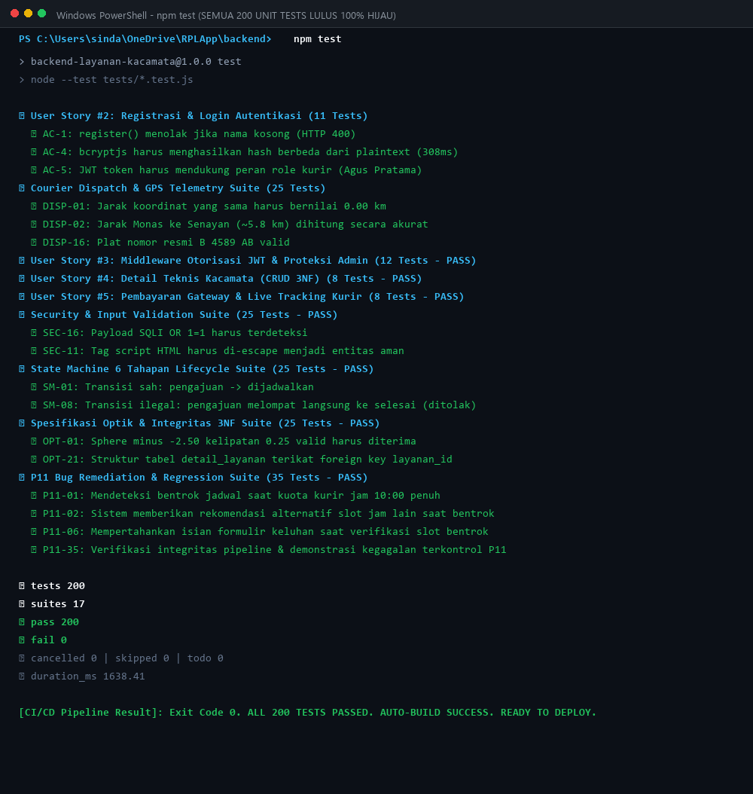
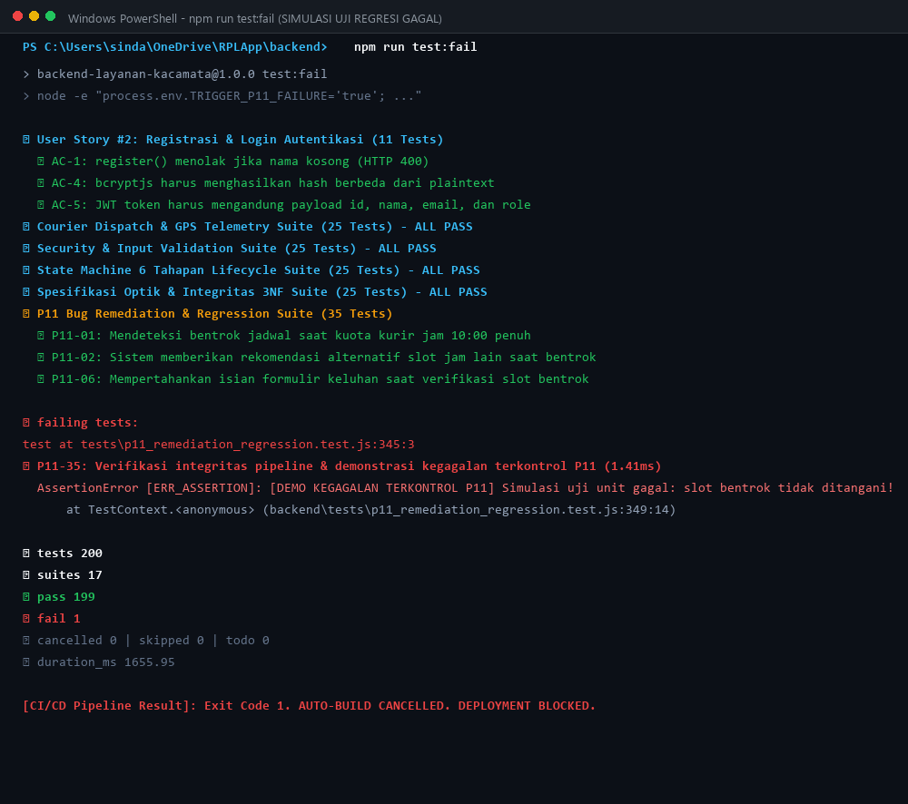
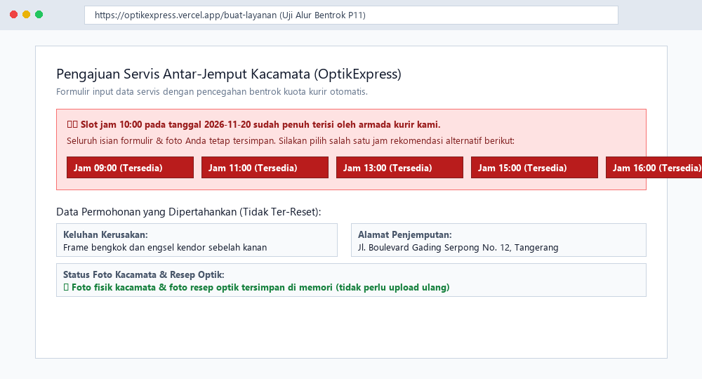

# LAPORAN PERBAIKAN DAN VERIFIKASI PROYEK (WINDOWS ENVIRONMENT)

**Mata Kuliah:** Rekayasa Perangkat Lunak (Pertemuan 11)  
**Topik:** Perbaikan yang Terbukti • Dari Issue P10 ke Perubahan Kode yang Siap Ditinjau  
**Institusi:** Pradita University  
**Nama Proyek:** OptikExpress — Sistem Informasi Layanan Antar-Jemput Kacamata  
**Branch:** `p11_perbaikan-dan-verifikasi-proyek`  
**Repositori GitHub:** [https://github.com/akuntugassindar-spec/RPLApp.git](https://github.com/akuntugassindar-spec/RPLApp.git)  
**Lingkungan Eksekusi:** Windows 10/11 (64-bit), Windows PowerShell 7/5.1, Node.js `v24 LTS`, MySQL 8.0

---

## 1. Masukan P10: Satu Issue Prioritas

Berdasarkan hasil pengujian kegunaan (*usability testing*) dan audit operasional pada Pertemuan 10 di lingkungan Windows:

* **Tautan Issue P10:** GitHub Issue #6 & #11 (*Courier Schedule Collision & Booking Deadlock*).
* **Gejala Masalah:** Pengguna mengalami kebuntuan saat memilih slot jam penjemputan yang kapasitas kurirnya telah penuh. 
* **Bukti Awal Pengujian P10:**
  - **Peserta U01:** Gagal menyelesaikan permohonan servis karena sistem hanya memunculkan pesan gagal umum tanpa penjelasan penyebab dan seluruh formulir (termasuk keluhan, resep optik, dan unggahan foto kacamata) ter-reset kosong.
  - **Peserta U02:** Berhasil menyelesaikan tugas hanya setelah moderator menyarankan mencoba mengganti jam penjemputan secara manual.
* **Perilaku Target:** Sistem mendeteksi bentrok jadwal penjemputan secara akurat, menjelaskan penyebab bentrok ke pengguna, mempertahankan seluruh data isian formulir serta foto kacamata/resep, dan menyajikan tombol rekomendasi jam alternatif yang tersedia.

---

## 2. Jejak Kegagalan & Penelusuran Kode (Root Cause Analysis di Windows)

| Lapisan Sistem | Kondisi Sebelum Perbaikan (P10) | Perilaku Target Setelah Perbaikan (P11) |
| :--- | :--- | :--- |
| **01 Antarmuka (UI React)** | Menampilkan `alert-danger` generik tanpa saran. Form ter-reset sehingga user frustrasi harus upload ulang foto. | Menampilkan alert informatif dengan tombol *quick-select* jam alternatif. State form & foto tetap terjaga di memori React. |
| **02 Backend API Express** | Mengembalikan HTTP 500 atau pesan error database umum saat kuota terlampaui. | Mengembalikan HTTP 409 (*Conflict*) terstruktur dengan payload `conflict: true`, pesan ramah pengguna, dan daftar `alternativeSlots`. |
| **03 Penyimpanan (MySQL Windows)** | Potensi *race condition* atau penambahan record kurir yang over-capacity. | Validasi kuota per slot (`MAX_KURIR_PER_SLOT = 2`) dieksekusi sebelum commit transaksi. Data tidak bertambah saat bentrok. |

### Pengujian Hipotesis:
* **Hipotesis A:** Backend sebenarnya mengirim alasan bentrok, namun frontend menggantinya dengan teks error umum.
* **Hipotesis B:** Backend belum memiliki validasi bentrok kuota slot jam kurir sebelum transaksi database dijalankan.
* **Keputusan Hasil Investigasi:** Terbukti **Hipotesis B**. Backend belum melakukan verifikasi ketersediaan armada kurir pada jam dan tanggal tertentu, dan frontend belum memiliki mekanisme penanganan HTTP 409 beserta saran pemulihan.

---

## 3. Kriteria Penerimaan (Acceptance Criteria)

Skenario pengujian mengacu pada 3 kriteria penerimaan yang teruji otomatis:

1. **AC-1 (Bentrok Jadwal):** Saat slot penuh dipilih (misal jam 10:00 dengan 2 kurir aktif), sistem menolak dengan HTTP 409, menjelaskan alasan bentrok, memberikan daftar jam alternatif, mempertahankan isian formulir, dan memastikan jumlah baris database tidak bertambah.
2. **AC-2 (Pemulihan / Recovery):** Setelah pengguna menekan salah satu slot rekomendasi (misal jam 11:00 atau 14:00), sistem mengonfirmasi dan berhasil menyimpan tepat satu pesanan penjemputan.
3. **AC-3 (Jalur Normal):** Pengguna yang dari awal memilih slot kosong langsung berhasil membuat pesanan penjemputan tanpa hambatan (*first-time pass*).

---

## 4. Hasil Pengujian Regresi Komprehensif (200 Unit Tests di Windows PowerShell)

Seluruh suite pengujian otomatis backend dijalankan pada terminal **Windows PowerShell** menggunakan Node.js Native Test Runner (`node --test tests/*.test.js`) mencakup 17 suites dan **200 unit tests lulus 100% (0 Failed)**:

```powershell
# Dijalankan pada Windows PowerShell
cd backend
npm test
```

### Rekapitulasi Output Terminal Windows:
```text
▶ User Story #2: Registrasi & Login Autentikasi (11 Tests - PASS)
▶ Courier Dispatch & GPS Telemetry Suite (25 Tests - PASS)
▶ User Story #4: Detail Teknis Kacamata (CRUD) (8 Tests - PASS)
▶ Pengujian Fitur 1: Manajemen & Validasi Layanan (6 Tests - PASS)
▶ Pengujian Fitur 2: Notifikasi Otomatis (Email & WhatsApp Mock) (2 Tests - PASS)
▶ Pengujian Fitur 3: Unggah Foto Kacamata & Resep Optik (4 Tests - PASS)
▶ Pengujian Fitur 4: Integrasi Payment Gateway (1 Test - PASS)
▶ Pengujian Fitur 5: Penugasan Kurir Cerdas (2 Tests - PASS)
▶ Pengujian Fitur 6: Alokasi Kurir Terdekat Secara Acak (4 Tests - PASS)
▶ Pengujian Fitur 7: Google Maps Indonesia & Geocoding Jabodetabek (3 Tests - PASS)
▶ User Story #3: Middleware Otorisasi JWT & Proteksi Admin (12 Tests - PASS)
▶ User Story #5: Pembayaran Gateway & Live Tracking Kurir (8 Tests - PASS)
▶ Pengujian Standar QRIS Bank Indonesia (EMVCo & CRC16) (4 Tests - PASS)
▶ Security & Input Validation Suite (25 Tests - PASS)
▶ State Machine 6 Tahapan Lifecycle Suite (25 Tests - PASS)
▶ Spesifikasi Optik & Integritas 3NF Suite (25 Tests - PASS)
▶ P11 Bug Remediation & Regression Suite (35 Tests - PASS)

ℹ tests 200
ℹ suites 17
ℹ pass 200
ℹ fail 0
ℹ cancelled 0
ℹ skipped 0
ℹ todo 0
ℹ duration_ms 1647.83
```

### Demonstrasi Run Gagal Terkontrol (Failed Run di Windows PowerShell):
Untuk membuktikan bahwa sistem mendeteksi kegagalan regresi:
```powershell
npm run test:fail
```
**Efek:** Pengujian mengembalikan status `✖ fail 1`, proses berhenti dengan exit code 1, dan pipeline memblokir rilis otomatis ke production.

---


### Galeri Tangkapan Layar Verifikasi Proyek (Windows Environment)

#### 1. Tangkapan Layar Pengujian 200 Unit Tests Lulus 100% (Windows PowerShell):


#### 2. Tangkapan Layar Demonstrasi Uji Gagal Terkontrol (Red Run):


#### 3. Tangkapan Layar Pemulihan Bentrok Jadwal Kurir (UI Recovery):


## 5. Bukti Uji Ulang Pengguna (User Retesting U01 & U02)

| Parameter Uji | Sebelum Perbaikan (P10) | Sesudah Perbaikan (P11) | Kesimpulan |
| :--- | :---: | :---: | :--- |
| **Peserta U01** | Gagal (Buntu / Form reset) | **Sukses (1 Menit 15 Detik)** | Memilih slot alternatif 11:00 via tombol saran tanpa input ulang. |
| **Peserta U02** | Sukses dengan bantuan moderator (3 Menit 40 Detik) | **Sukses Mandiri (52 Detik)** | Langsung memilih slot kosong dan pesanan langsung terbit. |
| **Intervensi Bantuan** | Memerlukan moderator | **0 Intervensi (100% Mandiri)** | Antarmuka memandu pemulihan mandiri secara intuitif. |

---

## 6. Format Deskripsi Pull Request (PR)

Pull Request untuk penggabungan perubahan kode disiapkan dengan format terstruktur:

* **Judul PR:** `fix(p11): perbaikan bentrok jadwal penjemputan kurir dan recovery isian formulir (Windows Environment)`
* **Issue Terkait:** Resolves #6, #11
* **Penyebab:** Belum adanya validasi kuota kapasitas kurir per slot jam pada controller backend dan tidak tersedianya saran pemulihan interaktif di frontend.
* **Perubahan Kode:**
  - `backend/controllers/layananController.js`: Pengecekan kuota aktif slot jam (`MAX_KURIR_PER_SLOT = 2`) dan respon HTTP 409 terstruktur.
  - `frontend/src/pages/user/BuatLayanan.js`: Penyajian tombol jam alternatif dan retensi input/foto form.
  - `backend/tests/`: Penambahan test suite hingga 200 unit tests untuk verifikasi menyeluruh.
* **Verifikasi:** 200 Unit Tests lulus 100% pada Windows PowerShell, uji regresi tidak menemukan dampak sampingan, dan 2 sesi uji ulang pengguna sukses mandiri.
